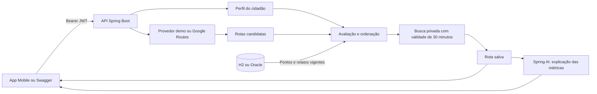
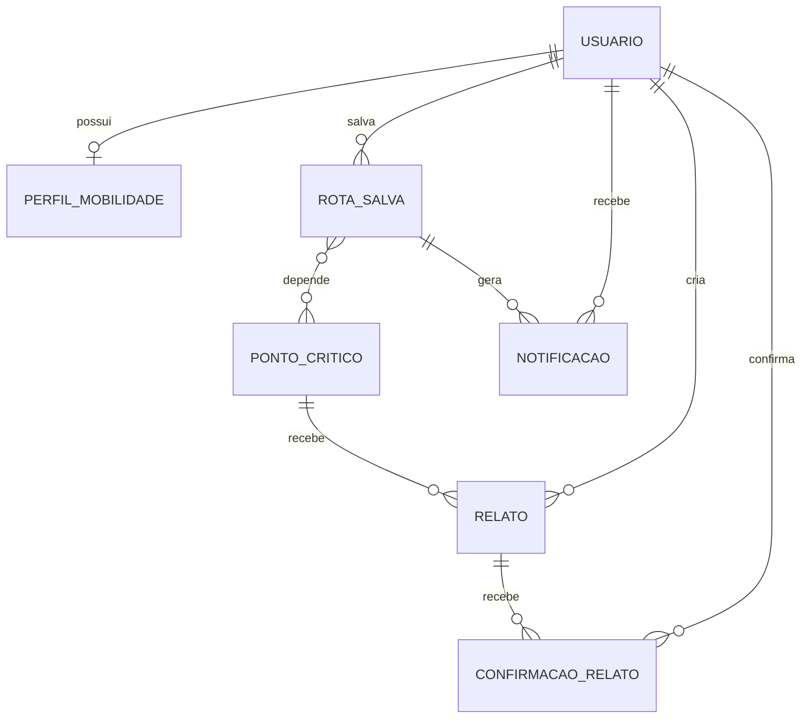
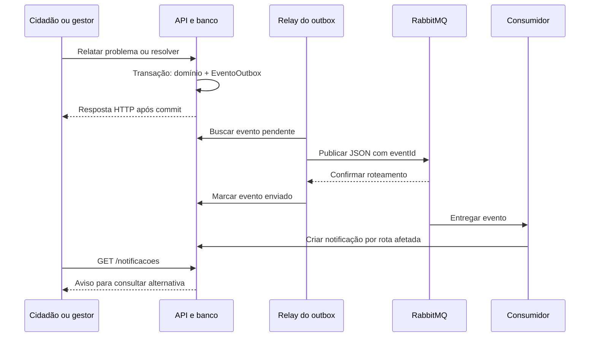

# Arquitetura do Rota Leve

## Caminho de uma busca

O provedor busca transporte. `AcessibilidadeService` aplica regras explícitas. O LLM explica métricas já calculadas e não decide quais barreiras existem. A busca persistida pertence ao usuário: o cliente pode salvar uma alternativa retornada pelo servidor, sem inventar o próprio retrato de rota. O detalhe de uma rota salva recalcula a avaliação com o perfil e as condições atuais.

## Relacionamentos

`ConsultaRota` guarda candidatas e o identificador do dono por 30 minutos. `EventoOutbox` guarda a publicação pendente e suas tentativas; os dois são registros de suporte. As relações principais usam chaves estrangeiras. Há unicidade de e-mail, perfil por usuário, confirmação por usuário e relato, e notificação por evento e rota.

## Alerta sem perder a alteração do banco

Rollback do domínio também elimina a intenção de publicar. Falha de conexão mantém o evento pendente com atraso progressivo. Uma publicação repetida conserva o mesmo `eventId`; a restrição única impede aviso duplicado. O consumidor tenta três vezes e rejeita para a DLQ em caso de falha persistente. A fila pode ser inspecionada no painel RabbitMQ.

Sem broker, o relay chama o consumidor localmente, em outra execução e depois do commit original. Esse modo permite apresentar o domínio, mas não comprova a integração distribuída. Notificação aqui significa registro consultável na API; push do celular e e-mail não estão implementados.

## Regras de avaliação

Primeiro vem a compatibilidade; depois a nota decrescente; em empate, a duração. Uma nota alta nunca libera uma restrição física. A nota inicial é 100 e fica limitada a 0–100.

| Condição | Efeito |
|---|---|
| Caminhada maior que o máximo do perfil | Incompatível; -50 |
| Caminhada dentro do limite | Desconto proporcional de até 15 |
| Escadas e restrição de escadas, obrigatória para cadeirante | Incompatível; -60 |
| Presença de escadas desconhecida | Dados insuficientes; -20 |
| Embarque inacessível para cadeirante | Incompatível; -60 |
| Embarque desconhecido para cadeirante | Dados insuficientes; -20 |
| Prioridade de assento sem informação positiva | -10 |
| Cobertura ausente ou desconhecida | -5 |
| Ponto necessário com problema vigente | Incompatível; -60 por ponto |
| Ponto sem verificação recente | Dados insuficientes; -20 por ponto |

O tratamento de qualquer problema em um ponto necessário é conservador neste MVP. Refinar a severidade de cobertura, assento e barreiras por perfil é uma evolução; o score atual é uma heurística explícita. Dados Google não trazem comprovação de acessibilidade nem vínculo automático com os pontos locais e permanecem com dados insuficientes.

Uma verificação de ponto vale 24 horas. Um relato ativo vale 48 horas sem nova confirmação. Expirar não comprova conserto: a condição passa a desconhecida quando não resta outro relato vigente. Um gestor não pode ignorar relatos ainda ativos ao alterar diretamente um ponto. Resolver um dos relatos não libera o ponto se outro relato continua ativo.

## Segurança e fronteiras

JWT assinado com HMAC-SHA256, emissor validado, expiração padrão de duas horas e consulta ao usuário/papel atual no banco. Senhas usam BCrypt. Cadastro público sempre cria cidadão. Gestores iniciais são criados no demo ou pelo bootstrap de produção configurado pelo operador. Dados de perfil, buscas, rotas e avisos pertencem ao usuário autenticado.

O segredo local e as contas conhecidas pertencem à demonstração. O perfil `prod` exige segredo e credenciais de Oracle via ambiente. CORS permite as origens exatas configuradas de Expo Web; aplicativos móveis nativos não dependem dessa configuração. O aplicativo Mobile integrado é entregue em pacote separado. O upload regrava JPEG/PNG verificados em disco, sem classificação visual por IA. Serviços .NET e procedimentos da disciplina de banco não fazem parte deste pacote Java.
